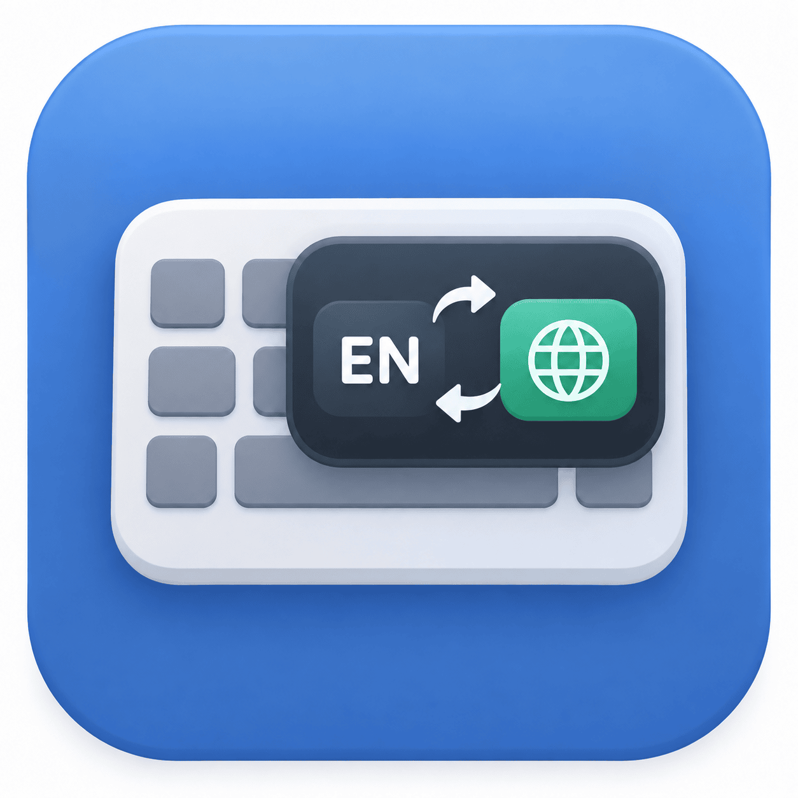
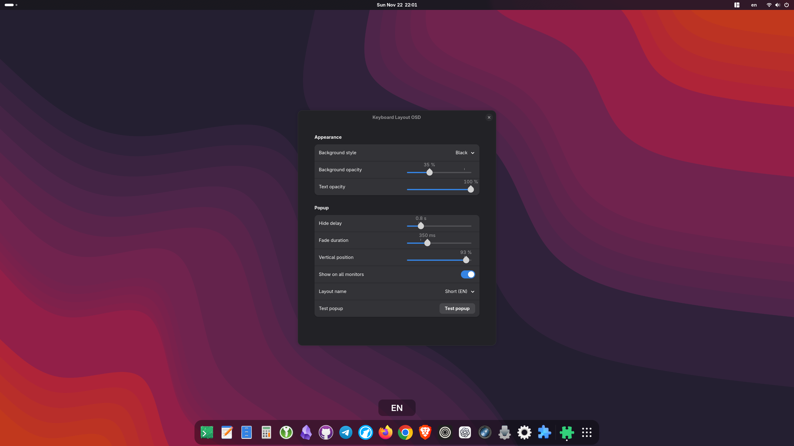

<p align="center">
  
</p>

# Keyboard Layout OSD

Shows a brief on-screen display when you switch keyboard layouts or input
languages in GNOME Shell 50 or 51.

[Install from GNOME Extensions](https://extensions.gnome.org/extension/10919/keyboard-layout-osd/).
Open preferences from the Extensions application to configure the popup.

<p align="center">
  
</p>

- Short, localized, or full layout names from GNOME
- System, light, dark, and black styles with separate background and text opacity
- Adjustable timing, vertical position, and display on all monitors
- Built-in test popup

<details>
<summary>Preferences screenshot</summary>



</details>

## NixOS

Use Home Manager to install and enable `pkgs.gnomeExtensions.keyboard-layout-osd`.

```nix
programs.gnome-shell = {
  enable = true;
  extensions = [ { package = pkgs.gnomeExtensions.keyboard-layout-osd; } ];
};
```

For system-wide installation, add the package to `environment.systemPackages`
and enable it in the Extensions application. Apply your configuration and log
out and back in. [Find the package in NixOS Packages](https://search.nixos.org/packages?channel=unstable&query=keyboard-layout-osd).

<details>
<summary>Flake fallback for newer GNOME Shell support</summary>

If your pinned Nixpkgs package does not support your GNOME Shell version,
add this input to your flake.

```nix
inputs.keyboard-layout-osd = {
  url = "github:gruvery-systems/keyboard-layout-osd";
  inputs.nixpkgs.follows = "nixpkgs";
};
```

In the Home Manager example above, replace the package with
`inputs.keyboard-layout-osd.packages.${pkgs.stdenv.hostPlatform.system}.default`.
Pass `inputs` to Home Manager using
`home-manager.extraSpecialArgs = { inherit inputs; };` in NixOS, or
`extraSpecialArgs = { inherit inputs; };` in `homeManagerConfiguration` for
standalone Home Manager.

For system-wide installation, add
`inputs.keyboard-layout-osd.nixosModules.default` to your system's `modules`.
Apply your configuration and log out and back in.

</details>

## Source installation and development

Clone the repository, then compile its settings schema.

```bash
git clone https://github.com/gruvery-systems/keyboard-layout-osd \
  ~/.local/share/gnome-shell/extensions/keyboard-layout-osd@gruvery.systems
cd ~/.local/share/gnome-shell/extensions/keyboard-layout-osd@gruvery.systems
glib-compile-schemas schemas
```

Log out and back in, then enable the extension in the Extensions application.
After editing `prefs.js`, reopen preferences. After editing `stylesheet.css`,
disable and re-enable the extension. Recompile the schema after XML changes.
Changes to `extension.js` or a loaded schema require a fresh GNOME Shell process.
On Wayland, log out and back in or test with
`dbus-run-session -- gnome-shell --devkit --wayland`.

## License

Keyboard Layout OSD is licensed under the [GNU General Public License v3.0](LICENSE).

## Project

Developed by [Gruvery.Systems](https://gruvery.systems).
Source code and issue tracking are available on [GitHub](https://github.com/gruvery-systems/keyboard-layout-osd).
